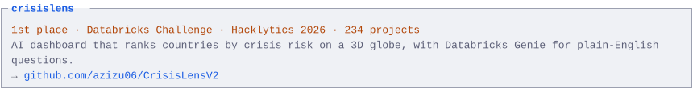
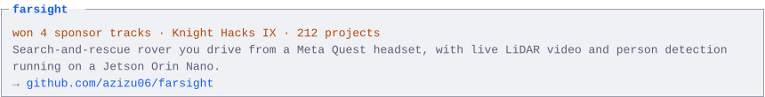
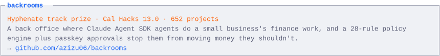
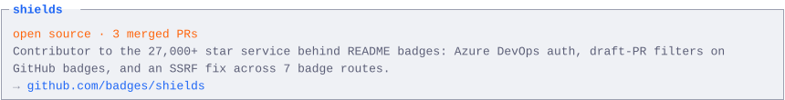
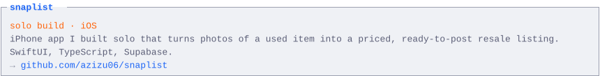

<!-- Generated by scripts/build_readme.py. Edit the script, not this file. -->

<a href="https://azizu.dev"><picture><source media="(max-width: 760px) and (prefers-color-scheme: dark)" srcset="assets/m-dark/hero.svg"><source media="(max-width: 760px)" srcset="assets/m-light/hero.svg"><source media="(prefers-color-scheme: dark)" srcset="assets/dark/hero.svg"></picture></a>

<a href="https://github.com/azizu06/CrisisLensV2"><picture><source media="(max-width: 760px) and (prefers-color-scheme: dark)" srcset="assets/m-dark/crisislens.svg"><source media="(max-width: 760px)" srcset="assets/m-light/crisislens.svg"><source media="(prefers-color-scheme: dark)" srcset="assets/dark/crisislens.svg"></picture></a> <a href="https://crisis-lens-v2-web.vercel.app"><picture><source media="(max-width: 760px) and (prefers-color-scheme: dark)" srcset="assets/m-dark/link-crisislens.svg"><source media="(max-width: 760px)" srcset="assets/m-light/link-crisislens.svg"><source media="(prefers-color-scheme: dark)" srcset="assets/dark/link-crisislens.svg"></picture></a>

<a href="https://github.com/azizu06/farsight"><picture><source media="(max-width: 760px) and (prefers-color-scheme: dark)" srcset="assets/m-dark/farsight.svg"><source media="(max-width: 760px)" srcset="assets/m-light/farsight.svg"><source media="(prefers-color-scheme: dark)" srcset="assets/dark/farsight.svg"></picture></a> <a href="https://youtu.be/AmrOGcTBTKU"><picture><source media="(max-width: 760px) and (prefers-color-scheme: dark)" srcset="assets/m-dark/link-farsight.svg"><source media="(max-width: 760px)" srcset="assets/m-light/link-farsight.svg"><source media="(prefers-color-scheme: dark)" srcset="assets/dark/link-farsight.svg"></picture></a>

<a href="https://github.com/azizu06/backrooms"><picture><source media="(max-width: 760px) and (prefers-color-scheme: dark)" srcset="assets/m-dark/backrooms.svg"><source media="(max-width: 760px)" srcset="assets/m-light/backrooms.svg"><source media="(prefers-color-scheme: dark)" srcset="assets/dark/backrooms.svg"></picture></a> <a href="https://youtu.be/dm1FlQTZYT8"><picture><source media="(max-width: 760px) and (prefers-color-scheme: dark)" srcset="assets/m-dark/link-backrooms.svg"><source media="(max-width: 760px)" srcset="assets/m-light/link-backrooms.svg"><source media="(prefers-color-scheme: dark)" srcset="assets/dark/link-backrooms.svg"></picture></a>

<a href="https://github.com/badges/shields/pulls?q=is%3Apr+author%3Aazizu06+is%3Amerged"><picture><source media="(max-width: 760px) and (prefers-color-scheme: dark)" srcset="assets/m-dark/shields.svg"><source media="(max-width: 760px)" srcset="assets/m-light/shields.svg"><source media="(prefers-color-scheme: dark)" srcset="assets/dark/shields.svg"></picture></a>

<a href="https://github.com/azizu06/snaplist"><picture><source media="(max-width: 760px) and (prefers-color-scheme: dark)" srcset="assets/m-dark/snaplist.svg"><source media="(max-width: 760px)" srcset="assets/m-light/snaplist.svg"><source media="(prefers-color-scheme: dark)" srcset="assets/dark/snaplist.svg"></picture></a>

<a href="https://azizu.dev"><picture><source media="(max-width: 760px) and (prefers-color-scheme: dark)" srcset="assets/m-dark/tab-1.svg"><source media="(max-width: 760px)" srcset="assets/m-light/tab-1.svg"><source media="(prefers-color-scheme: dark)" srcset="assets/dark/tab-1.svg"></picture></a>
<a href="https://linkedin.com/in/abduaziz-umarov"><picture><source media="(max-width: 760px) and (prefers-color-scheme: dark)" srcset="assets/m-dark/tab-2.svg"><source media="(max-width: 760px)" srcset="assets/m-light/tab-2.svg"><source media="(prefers-color-scheme: dark)" srcset="assets/dark/tab-2.svg"></picture></a>
<a href="https://devpost.com/azizu06"><picture><source media="(max-width: 760px) and (prefers-color-scheme: dark)" srcset="assets/m-dark/tab-3.svg"><source media="(max-width: 760px)" srcset="assets/m-light/tab-3.svg"><source media="(prefers-color-scheme: dark)" srcset="assets/dark/tab-3.svg"></picture></a>

